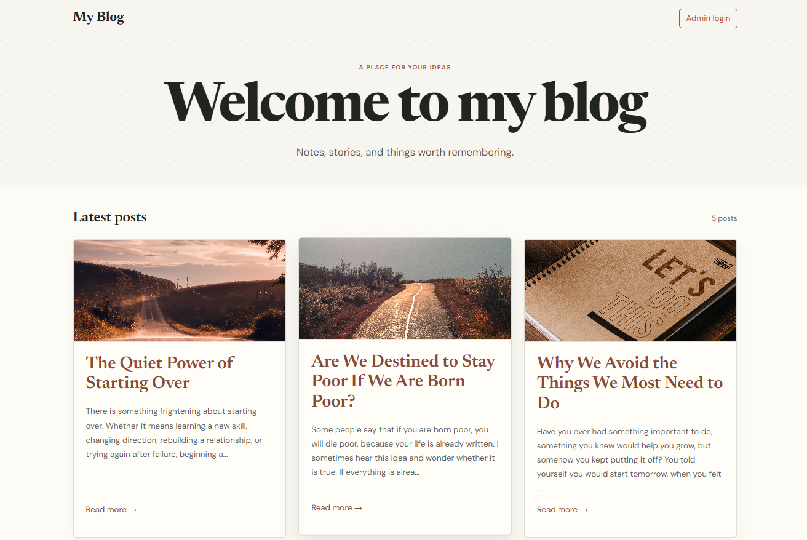
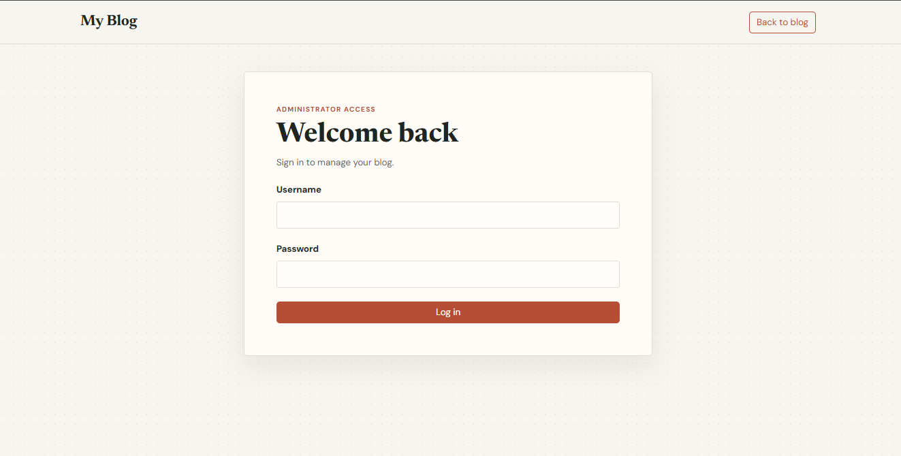
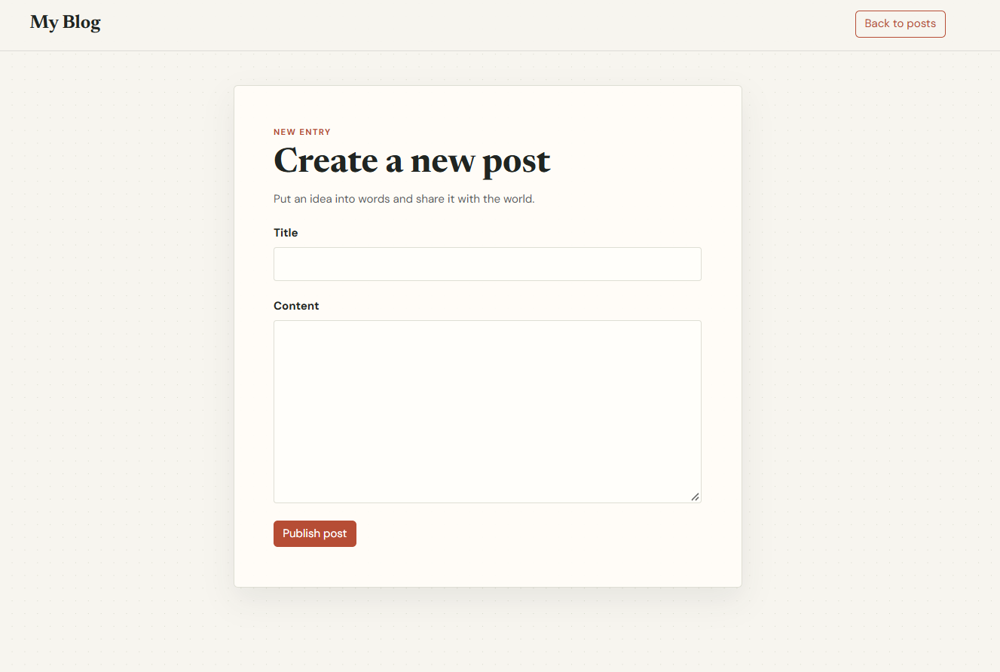

# Blog Web Application

A dynamic personal blog web application built with **Node.js, Express.js, EJS, and PostgreSQL**.

Visitors can browse and read published articles, while the administrator can securely create, edit, and delete posts through an authenticated interface.

**Live Demo:** https://blog-project-l6vx.onrender.com

**GitHub Repository:** https://github.com/hunmenghai/blog-project

## Screenshots

| Homepage | Article Page |
|---|---|
|  |  |

| Admin Login | Create Post |
|---|---|
|  |  |

## Features

### Public Features
- Browse published blog posts.
- Read individual articles.
- Responsive user interface.

### Admin Features
- Administrator login and logout.
- Create, edit, and delete blog posts.
- Upload and replace post images.
- Password hashing using bcrypt.
- Session-based authentication.

### Security
- CSRF protection.
- Login rate limiting.
- Secure session cookie configuration.
- Parameterized SQL queries.
- Image type validation and file-size restrictions.
- Environment variables for sensitive configuration.

## Technologies Used

| Category | Technologies |
|---|---|
| Backend | Node.js, Express.js |
| Frontend | HTML, CSS, JavaScript, EJS, Bootstrap |
| Database | PostgreSQL |
| Authentication | bcrypt, express-session |
| Image Upload | Multer |
| Image Storage | Cloudinary |
| Security | csrf-sync, express-rate-limit |
| Deployment | Render, Neon PostgreSQL |
| Version Control | Git, GitHub |

## Getting Started

### Prerequisites

- Node.js
- npm
- PostgreSQL or a Neon PostgreSQL database
- A Cloudinary account for image uploads

### Installation

1. Clone the repository:

   ```bash
   git clone https://github.com/hunmenghai/blog-project.git
   ```

2. Navigate to the project directory:

   ```bash
   cd blog-project
   ```

3. Install dependencies:

   ```bash
   npm install
   ```

4. Create a `.env` file in the project root:

   ```env
   PORT=3000
   DATABASE_URL=your_database_connection_string
   DB_PASSWORD=your_local_database_password
   CLOUDINARY_CLOUD_NAME=your_cloud_name
   CLOUDINARY_API_KEY=your_api_key
   CLOUDINARY_API_SECRET=your_api_secret
   SESSION_SECRET=your_session_secret
   ```

   Configure `DATABASE_URL` when using Neon PostgreSQL. For local PostgreSQL, configure `DB_PASSWORD` instead.

5. Set up the database:

   Execute the SQL statements in `schema.sql` to create the `posts` and `admins` tables.

6. Create an administrator account:

   ```bash
   node create-admin.js
   ```

   Enter your administrator username and password when prompted.

7. Start the application:

   ```bash
   node app.js
   ```

8. Open your browser:

   http://localhost:3000

## Environment Variables

| Variable | Purpose |
|---|---|
| `PORT` | Application port (defaults to 3000) |
| `DATABASE_URL` | Neon PostgreSQL connection string |
| `DB_PASSWORD` | Local PostgreSQL password |
| `CLOUDINARY_CLOUD_NAME` | Cloudinary cloud name |
| `CLOUDINARY_API_KEY` | Cloudinary API key |
| `CLOUDINARY_API_SECRET` | Cloudinary API secret |
| `SESSION_SECRET` | Express session secret |

Never commit your `.env` file or expose database credentials, API keys, or session secrets.

## Database Structure

The application uses PostgreSQL with three tables:

| Table | Purpose |
|---|---|
| `posts` | Stores blog articles and optional Cloudinary image URLs |
| `admins` | Stores administrator usernames and bcrypt password hashes |
| `user_sessions` | Stores persistent administrator session data |

The `posts` and `admins` tables are defined in `schema.sql`.

The `user_sessions` table is created automatically by `connect-pg-simple` when the application starts, if it does not already exist.

## Project Structure

```text
blog-project/
├── public/
│   ├── images/
│   └── styles.css
├── view/
│   ├── create.ejs
│   ├── edit.ejs
│   ├── index.ejs
│   ├── login.ejs
│   └── post.ejs
├── app.js
├── create-admin.js
├── schema.sql
├── package.json
├── package-lock.json
└── .gitignore
```

## Future Improvements

- Search functionality.
- Post categories and tags.
- Pagination.
- Improved administrator dashboard.
- Additional input validation and error handling.

## Author

Developed as part of the **Complete Web Development Bootcamp** capstone projects.