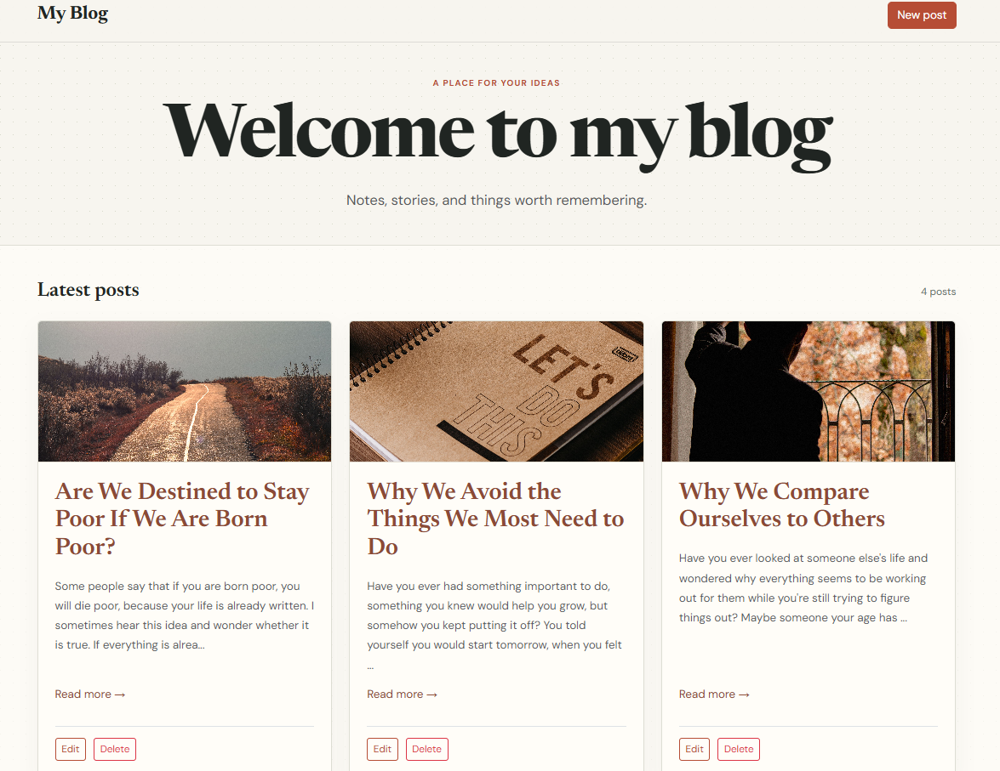
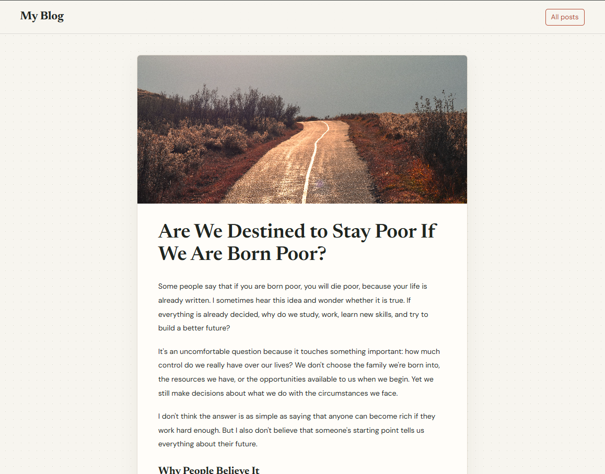
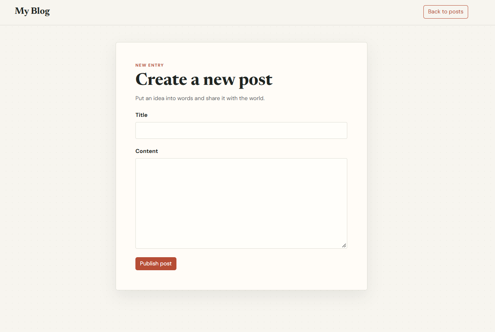

# My Blog — Full-Stack Blog Application

A full-stack blog application built with Node.js, Express, EJS, and PostgreSQL. It provides a clean, responsive interface for creating, reading, editing, and deleting articles, with Markdown support and featured images.

## Features

- **Create posts** — Write and publish blog articles.
- **Read articles** — Browse article previews on the homepage and open individual article pages.
- **Edit posts** — Update existing article titles and content.
- **Delete posts** — Remove unwanted articles.
- **Markdown rendering** — Format article content using Markdown.
- **HTML sanitization** — Sanitize rendered Markdown before displaying it.
- **Article images** — Display thumbnails on the homepage and featured images on individual article pages.
- **Responsive design** — A clean, editorial-style layout for desktop and smaller screens.
- **PostgreSQL integration** — Store and retrieve blog posts from a relational database.

## Tech Stack

| Technology | Purpose |
|---|---|
| Node.js | JavaScript runtime |
| Express.js | Web application framework |
| EJS | Server-side HTML templating |
| PostgreSQL | Relational database |
| `pg` | PostgreSQL client for Node.js |
| Bootstrap 5 | Responsive layout and UI components |
| CSS | Custom styling |
| Marked | Markdown parsing |
| sanitize-html | HTML sanitization |
| dotenv | Environment variable configuration |

## Screenshots

Add screenshots of your actual application to a `screenshots/` folder, then uncomment or add the corresponding image references below.


### Homepage


### Individual Article Page


### Create a Post


## Getting Started

### Prerequisites

Make sure you have installed:

- [Node.js](https://nodejs.org/)
- [PostgreSQL](https://www.postgresql.org/)
- [Git](https://git-scm.com/)

### 1. Clone the repository

```bash
git clone https://github.com/hunmenghai/blog-project.git
cd blog-project
```

### 2. Install dependencies

```bash
npm install
```

### 3. Create the database

Open PostgreSQL using pgAdmin or your preferred PostgreSQL client.

Create a database named `blog`:

```sql
CREATE DATABASE blog;
```

Then execute the SQL statements in `schema.sql` against the `blog` database to create the required table.

### 4. Configure environment variables

Create a `.env` file in the project root:

```env
DB_PASSWORD=your_postgresql_password
```

Replace `your_postgresql_password` with your local PostgreSQL password.

The application currently connects using:

- **Host:** `localhost`
- **Port:** `5432`
- **Database:** `blog`
- **User:** `postgres`

If your PostgreSQL configuration differs, update the database settings in `app.js` as needed.

**Security:** Never commit your `.env` file or publish database credentials.

### 5. Start the application

Start the development server using Nodemon:

```bash
npx nodemon app.js
```

Nodemon automatically restarts the server when you make changes to your application files.

If Nodemon is installed globally, you can also run:

```bash
nodemon app.js
```

Open your browser and visit:

http://localhost:3000


## Project Structure

```text
blog-project/
├── public/
│   ├── images
│   │   ├── comparison.jpg
│   │   ├── learning.jpg
│   │   ├── poverty.jpg
│   │   └── procrastination.jpg
│   └── styles.css
├── screenshots/
│   ├── artical-page.png
│   └── create-post.png
│   └── homepage.png
├── view/
│   ├── create.ejs
│   ├── edit.ejs
│   ├── index.ejs
│   └── post.ejs
├── .gitignore
├── app.js
├── package.json
├── package-lock.json
├── schema.sql
└── README.md
```


## What I Learned

Through this project, I practiced:

- Building server-side web applications with Express.js.
- Connecting a Node.js application to PostgreSQL.
- Implementing CRUD operations.
- Rendering dynamic pages using EJS.
- Handling HTML forms and HTTP routes.
- Parsing Markdown and sanitizing HTML.
- Managing environment variables securely.
- Organizing static assets and styling responsive pages.
- Using Git and GitHub for version control.

## Future Improvements

- Add user authentication and authorization.
- Add pagination for larger collections of posts.
- Implement post search and filtering.
- Improve form validation and error handling.
- Allow users to upload or select article images dynamically.
- Deploy the application online.

## Author

**Hun Menghai**

- GitHub: [@hunmenghai](https://github.com/hunmenghai)

---

Built as a full-stack web development project.
